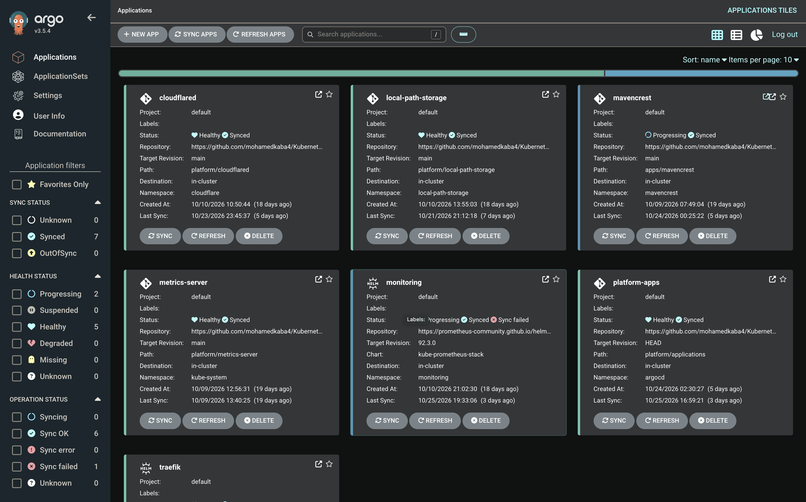
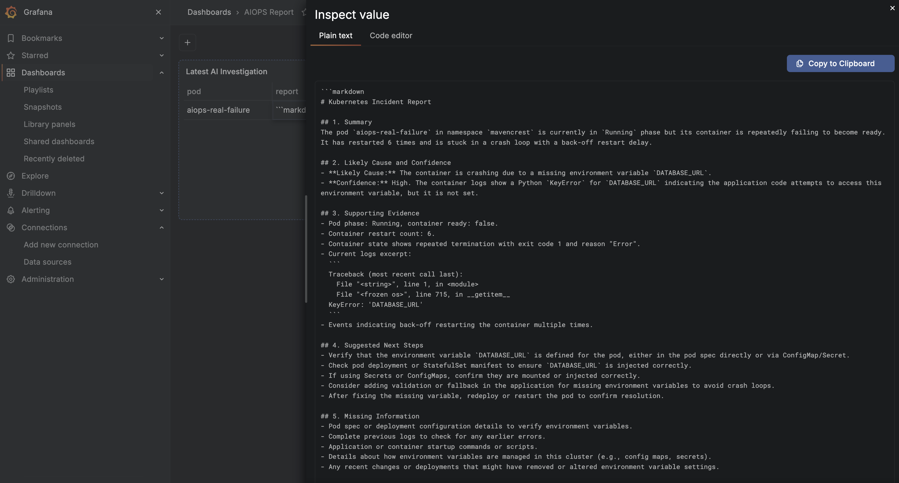

# Kubernetes Platform (On-Prem)

A self-hosted Kubernetes platform I built and manage using Ubuntu VMs across two physical machines. I created this environment to gain hands-on experience with Kubernetes and the tools and workflows used in production environments like Amazon EKS and Azure AKS.

The cluster hosts my Mavencrest e-commerce storefront, with GitOps used to manage application deployments and supporting platform services.

## Architecture

**Application Traffic**

Internet → Cloudflare Tunnel → Traefik Ingress → Kubernetes Services → Application Pods

**GitOps**

GitHub → Argo CD (App-of-Apps) → Kubernetes Cluster

**Observability**

Kubernetes / Traefik → Prometheus → Grafana / Alertmanager

AWS CloudWatch (CloudFront & S3) → Grafana

The platform uses kubeadm and containerd, with Flannel for pod networking and Tailscale for remote connectivity between nodes.

## Tech Stack

| Category | Technologies |
|---|---|
| Kubernetes | kubeadm, containerd, Helm, Kustomize |
| Automation | Ansible |
| GitOps | Argo CD, App-of-Apps |
| Networking | Flannel, Traefik, Cloudflare Tunnel, Tailscale |
| Monitoring | Prometheus, Grafana, Alertmanager, AWS CloudWatch |
| Storage | NFS CSI, PersistentVolumes, PersistentVolumeClaims |
| Application | Next.js, Docker, Azure Container Registry |

## What I Implemented

- **GitOps:** Configured Argo CD using the App-of-Apps pattern to automatically deploy and reconcile Kubernetes resources from GitHub.
- **Application Deployment:** Deployed my Mavencrest e-commerce storefront using Kubernetes Deployments and Services, including startup, readiness, and liveness probes.
- **Ingress & Networking:** Configured Traefik and Cloudflare Tunnel to expose the storefront publicly over HTTPS without opening inbound ports on my home network.
- **Autoscaling:** Implemented Horizontal Pod Autoscaling (HPA), PodDisruptionBudgets, and topology spread constraints to improve application availability.
- **Infrastructure Automation:** Used Ansible to manage Ubuntu nodes and infrastructure configurations remotely from my Mac.
- **Persistent Storage:** Configured NFS CSI-backed storage for Grafana and Alertmanager to support workload relocation between workers.
- **Observability:** Deployed Prometheus, Grafana, and Alertmanager to monitor Kubernetes resources, application workloads, and ingress traffic.
- **AWS Integration:** Connected AWS CloudWatch to Grafana to monitor CloudFront and S3 metrics from my AWS-hosted portfolio website.

## GitOps & Argo CD

I configured Argo CD using the App-of-Apps pattern to manage Kubernetes applications and platform services through GitHub.

Changes pushed to the repository are automatically reconciled with the cluster, allowing me to manage deployments and configurations through Git rather than applying manifests manually.

Argo CD Application Dashboard



Argo CD dashboard showing the applications and platform services managed through GitOps.
## Observability & Monitoring

I deployed `kube-prometheus-stack` through Argo CD to collect metrics from the Kubernetes cluster and monitor infrastructure health.

Prometheus collects metrics from nodes, workloads, and Traefik. Grafana provides visualization, while Alertmanager handles alert routing.

I also integrated AWS CloudWatch as a Grafana data source to monitor AWS infrastructure alongside my Kubernetes environment.

### AWS CloudFront & S3 Operations Dashboard

Built a custom Grafana dashboard to monitor my AWS-hosted portfolio website.

The dashboard tracks CloudFront request traffic, HTTP error rates, bandwidth usage, hourly request intensity, S3 storage consumption, and object counts.


*Custom Grafana dashboard combining CloudFront traffic analytics, HTTP error monitoring, request-intensity visualization, and S3 storage metrics.*

**[View Grafana Dashboard JSON](dashboards/cloudfront-s3.json)**

### Traefik Ingress Monitoring

Enabled Prometheus metrics collection and ServiceMonitor discovery for Traefik.

This provides visibility into:

- HTTP request volume and response codes.
- Request latency and traffic patterns.
- Active connections and ingress-controller performance.

### AIOps — Automated Alert Investigation

A Python service that investigates Kubernetes failures and produces AI-assisted incident reports.

- **Prometheus** detects containers in `CrashLoopBackOff`.
- **Alertmanager** sends an authenticated webhook to the investigator.
- The investigator collects pod status, restart counts, events, and container logs.
- **OpenAI** analyzes the evidence and suggests likely causes and troubleshooting steps.
- Reports are saved to persistent storage; the latest report is available in **Grafana** through the Infinity data source.

The service uses namespace-scoped, read-only RBAC and does not modify workloads. Credentials are stored in Kubernetes Secrets, and Argo CD manages deployment.

**Validated:** A pod crashing from a missing `DATABASE_URL` automatically triggered an investigation and displayed the completed report in Grafana.



*Grafana dashboard displaying the latest automated Kubernetes investigation, with a compact report preview and an expandable view of the likely cause, supporting evidence, and suggested next steps.*

## Testing & Troubleshooting

Throughout the project, I worked through several Kubernetes deployment and infrastructure issues, including:

- Pod scheduling, recovery, rolling updates, and node draining.
- HPA configuration and resource allocation.
- Traefik ingress routing and Cloudflare Tunnel connectivity.
- Kubernetes API, kubelet, and Metrics Server connectivity.
- PersistentVolume and PVC node-affinity conflicts.
- Moving Grafana and Alertmanager workloads using NFS-backed storage.
- Argo CD synchronization and health-status troubleshooting.
- Prometheus ServiceMonitor discovery and Grafana metric queries.

## Repository Structure

```text
Kubernetes-DockingStation/
├── apps/
│   ├── mavencrest/             # Mavencrest application manifests
│   └── aiops/
│       ├── src/                # Evidence collection, AI analysis, report API
│       ├── k8s/                # Deployment, Service, storage, RBAC, alerting
│       ├── Dockerfile          # Investigator container image
│       └── requirements.txt    # Python dependencies
├── platform/
│   ├── applications/           # Argo CD child Applications
│   ├── argocd/                 # Argo CD installation and configuration
│   ├── cloudflared/            # Cloudflare Tunnel
│   ├── local-path-storage/     # Local persistent storage provisioner
│   ├── metrics-server/         # Kubernetes resource metrics
│   └── app-of-apps.yaml        # GitOps bootstrap
├── dashboards/                 # Grafana dashboard definitions
├── docs/
│   └── images/                 # Architecture diagrams and screenshots
└── README.md
```

VM provisioning and operating system management are handled separately through my Ansible repository.

## Current Limitations

- **Control Plane:** The cluster currently uses a single control-plane node, so the Kubernetes API is not highly available.
- **Storage:** NFS allows stateful workloads to move between workers but still depends on the underlying NFS server.
- **Infrastructure:** The platform runs on limited home-lab hardware rather than dedicated production infrastructure.

## Project Goal

Build and operate a Kubernetes environment using production-relevant practices for GitOps, automation, networking, observability, storage, scaling, and troubleshooting.

The goal is to develop practical Kubernetes and platform engineering skills that transfer to managed environments such as Amazon EKS and Azure AKS.
